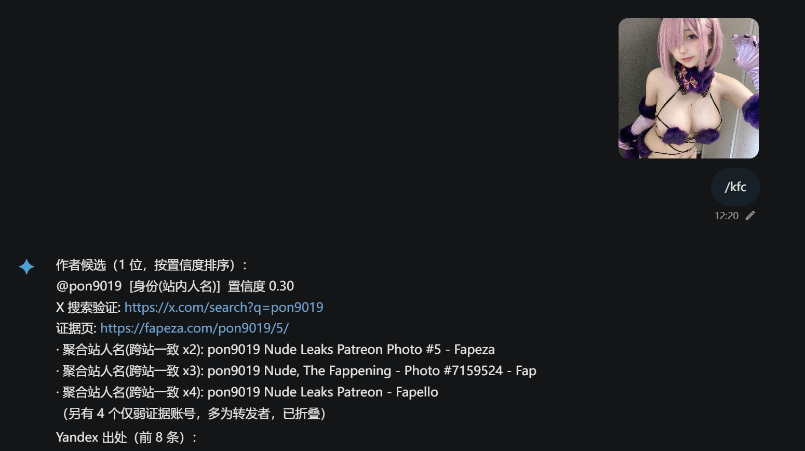

# astrbot_plugin_bitchfinder

AstrBot 反向图片搜索插件：发送图片，自动通过多引擎反向搜索，返回图片出处与作者账号（含 X 原帖、Coser 主页署名）。

## 用法

`找鸡` + 图片/引用图片

别名：`kfc`

## 示例

发送一张 Coser 图片（如 `sample.png`）并输入 `找鸡`，插件会返回该图的可能出处与作者账号，例如：

```
可能的作者账号（正文署名优先，相似度仅在同图时作数）：
✅ @mamamia1008  [X/Twitter] [正文署名] 图像相似度 98%
      页面: https://x.com/mamamia1008/status/...
      检索: https://x.com/search?q=from%3Amamamia1008
```




## 说明

- 引擎：Yandex(.com/.ru 双域名互备)、百度识图（默认开）、Copyseeker（可选）、
  SauceNAO（需 key）、ascii2d（需 cf_clearance）、Google Cloud Vision（需 key）、
  Google Lens（需 SerpApi key）。单引擎失败不影响其他引擎。
- 输出策略：只突出最优先候选（正文署名/官方引擎/感知哈希同图确认加权），
  其余候选折叠列出，附检索链接供人工确认。
- 兜底链：无可靠署名时调用已配置的 LLM 分析来源页文字提取账号线索
  （候选必须附原文证据并经程序验证，防幻觉/注入）；最优先两名并列时经
  fxTwitter 查粉丝数取多者（仅排序用，非归属证明）。
- 图片预处理：EXIF 方向纠正、>1600px 缩放、透明区填白转 JPEG、动图取首帧；
  合格图保留原始字节（重新编码会伤害反搜命中率）。
- 失败语义：验证页/风控拦截、第三方页 403、真正无结果分开报告——
  "被拦截"不等于"没有出处"。
- 不做任何账号建库、人脸库或跨平台身份聚合；结果均来自公开网页。
